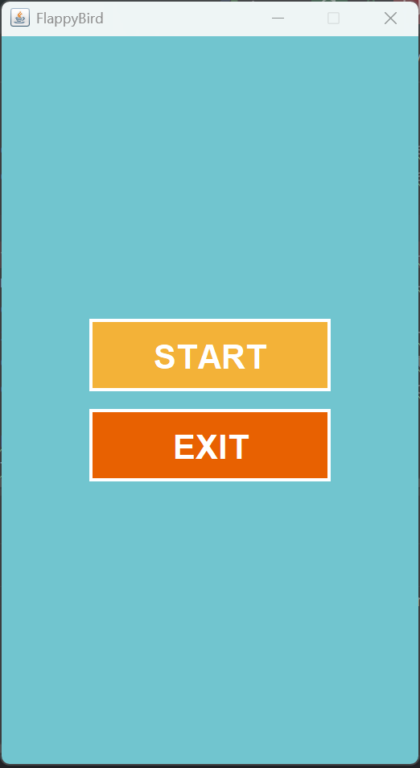
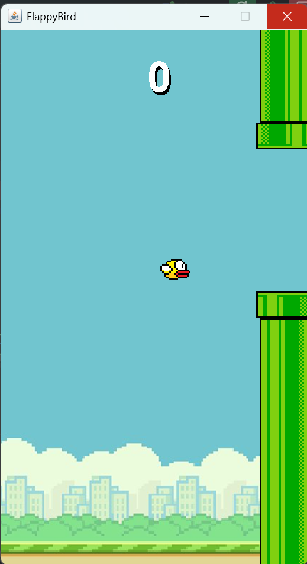
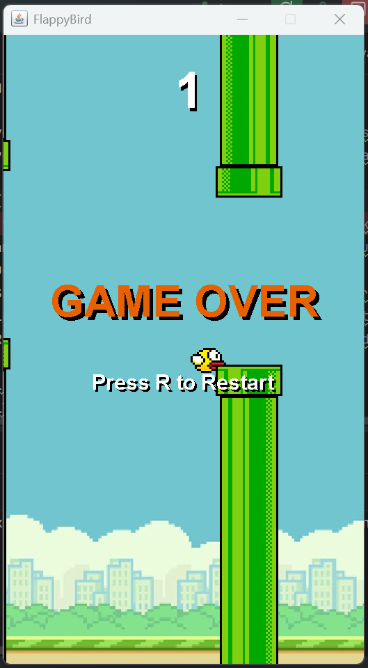

# TP6DPBO2526C2 - Flappy Bird (Java Swing GUI)

Saya Moch Fadillah Pratama dengan NIM 2506968 mengerjakan Tugas Praktikum 6 dalam mata kuliah Desain Pemrograman Berorientasi Objek untuk keberkahan-Nya maka saya tidak akan melakukan kecurangan seperti yang telah dispesifikasikan. Aamiin.

Repositori ini berisi proyek pembuatan ulang (*remake*) game **Flappy Bird** menggunakan pustaka antarmuka grafis Java Swing. Proyek ini dikembangkan untuk memenuhi Tugas Praktikum Desain Pemrograman Berorientasi Objek (DPBO).

## 🧩 Desain Program

Program ini dirancang menggunakan konsep Pemrograman Berorientasi Objek (OOP) dengan memisahkan komponen visual, entitas, dan logika permainan ke dalam kelas-kelas yang berbeda (arsitektur *Model-View-Controller* yang dimodifikasi).

Terdapat 5 kelas utama dalam proyek ini:
1. **`App.java` (Main/Window):** Berfungsi sebagai titik masuk (*entry point*) program. Menginisialisasi `JFrame`, merakit jendela aplikasi, serta mengelola antarmuka Menu Utama (tombol *Start* dan *Exit*).
2. **`Logic.java` (Controller/Mesin):** Otak dari permainan. Menangani kalkulasi fisika (gravitasi), deteksi tabrakan (*collision*), sistem skor, penghitung waktu (*Game Loop* menggunakan `Timer`), pembacaan *input keyboard*, hingga pemutaran audio (BGM).
3. **`View.java` (View/Kanvas):** Perpanjangan dari `JPanel` yang bertugas me-render/menggambar seluruh elemen visual permainan (burung, pipa, warna latar, tipografi skor, dan teks layar *Game Over*) ke monitor pengguna secara dinamis 60 FPS.
4. **`Player.java` (Model):** Representasi entitas pemain (burung). Menyimpan atribut penting seperti titik koordinat X dan Y, ukuran (*hitbox*), dan kecepatan jatuh vertikal.
5. **`Pipe.java` (Model):** Representasi rintangan. Menyimpan titik koordinat, batas ukuran, status penanda skor (*passed*), dan kecepatan laju pipa.

## 🔄 Penjelasan Alur Permainan

1. **Inisialisasi & Main Menu:** 
   Saat program dijalankan, `App.java` merender Menu Utama yang menutupi layar permainan. Pengguna disuguhkan tombol "START" dan "EXIT". Layar permainan dan logika masih dalam keadaan statis (*idle*).
2. **Memulai Permainan (*Game Loop*):** 
   Ketika tombol "START" ditekan, jendela aplikasi akan mengganti panel menu dengan panel `View`. Fungsi `startGame()` pada `Logic` akan dipanggil, yang mana akan menghidupkan *Timer* `gameLoop` (60 FPS), *Timer* `pipesCooldown` (mencetak pipa per 1.5 detik), dan memutar file audio BGM secara berulang (*loop*).
3. **Mekanika Inti:**
   Setiap satu detak *frame*, program menarik objek `Player` ke bawah (menggunakan penambahan nilai gravitasi) dan menggeser deretan `Pipe` ke kiri. Ketika pengguna menekan tombol `SPACE`, program merespons dengan memberikan nilai kecepatan vertikal negatif (ke atas) pada burung sehingga burung seolah "melompat".
4. **Sistem Skor & *Game Over* (Deteksi Tabrakan):**
   - **Skor:** Ketika posisi burung berhasil melewati koordinat sumbu X bagian kanan suatu rintangan pipa, skor bertambah (diatur +0.5 per balok atas/bawah, total 1 per celah).
   - **Tabrakan (AABB Collision):** Jika koordinat *hitbox* burung bersinggungan dengan *hitbox* pipa atau jatuh melewati tinggi layar aplikasi, maka variabel `gameOver` bernilai `true`. Seluruh *Timer* akan dihentikan (layar membeku), dan *View* akan memunculkan teks "GAME OVER".
5. **Fitur *Restart*:**
   Saat berstatus *Game Over*, jika pengguna menekan tombol `R` pada *keyboard*, sistem akan mereset koordinat posisi burung, mengosongkan daftar pipa, mengembalikan skor menjadi 0, dan menyalakan kembali seluruh *Timer*.

## 📸 Dokumentasi

### Tampilan Main Menu

### Permainan & Sistem Skor

### Layar Game Over

### Video Screenrecord Permainan
[Tonton Video Demonstrasi Program](Dokumentasi/demo.mp4)
